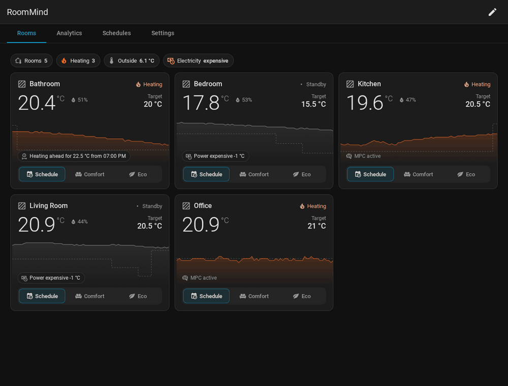
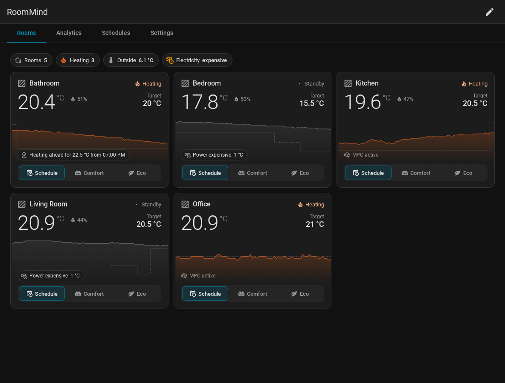
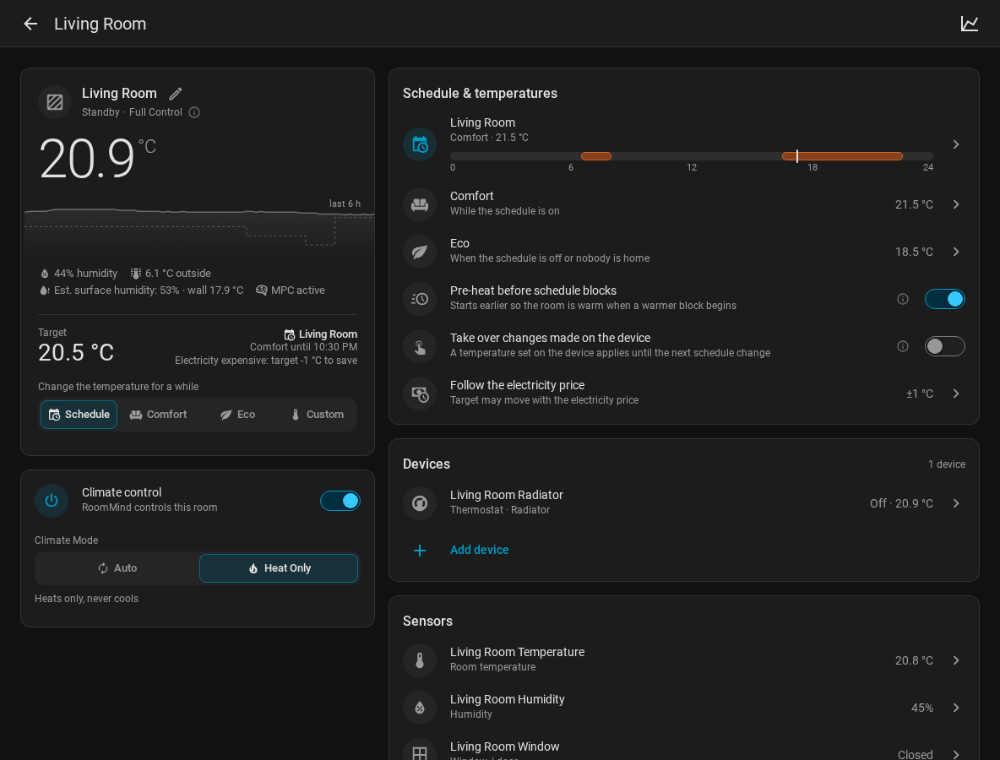
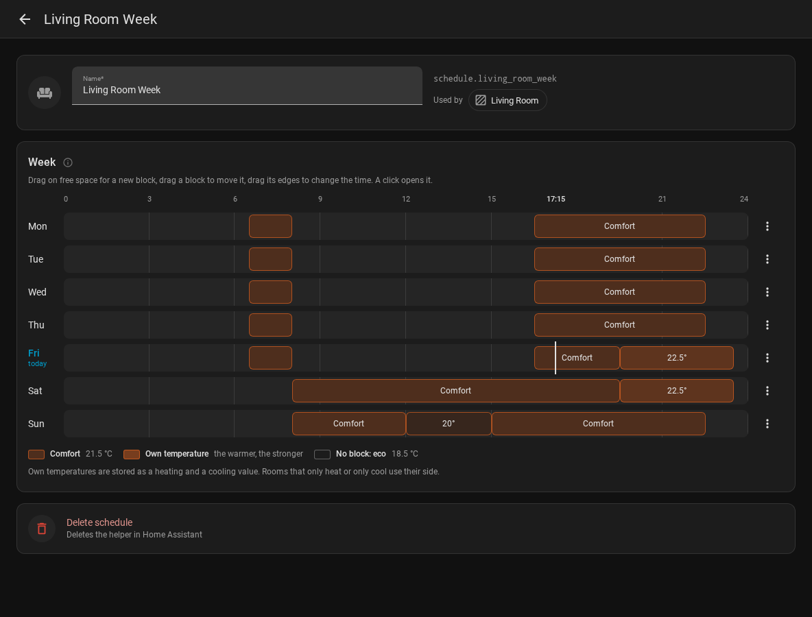
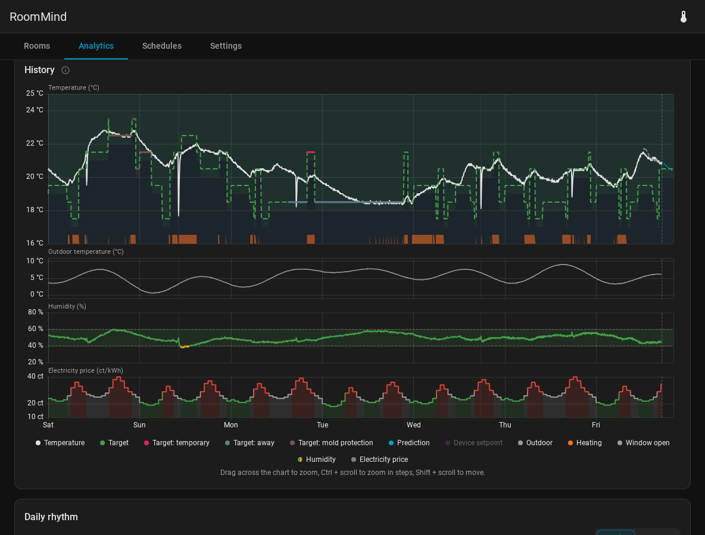
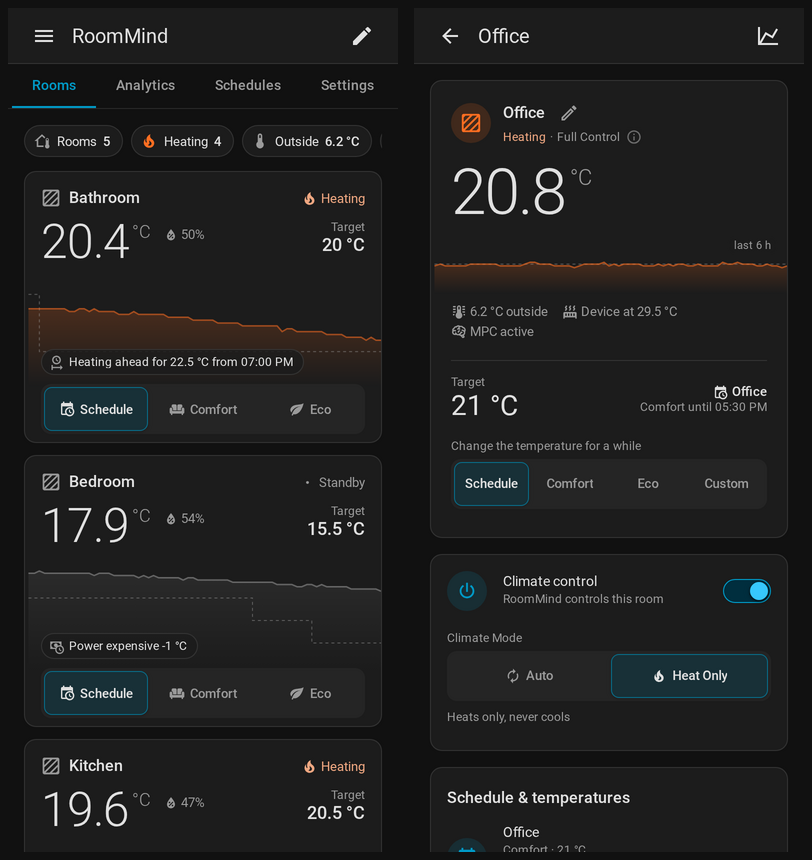

<div align="center">

# RoomMind

**Room-by-room climate control for Home Assistant that learns how your home heats and cools.**

[](https://my.home-assistant.io/redirect/hacs_repository/?owner=snazzybean&repository=roommind&category=integration)
[](https://www.home-assistant.io/)
[](https://github.com/snazzybean/roommind/releases/latest)
[](https://github.com/snazzybean/roommind/actions/workflows/ci.yml)

[](https://github.com/snazzybean/roommind/blob/main/LICENSE)
[](https://ko-fi.com/Y8Y31VP2VK)



</div>

RoomMind turns the thermostats, radiator valves and air conditioners you already have into one controller per room. It learns how quickly each room warms up, cools down and reacts to the sun, then plans ahead: the room is warm when the schedule says so and heating stops before it overshoots. You set it up in its own panel in Home Assistant, without YAML, and everything runs locally.

- 🎯 **Warm on time.** Heats ahead of the next schedule block and stops early enough for the radiator's afterglow.
- 🔌 **Works with your devices.** Any `climate` entity: radiator valves, ACs, heat pumps, underfloor heating, also mixed in one room.
- 🧭 **Set up in minutes.** Rooms, schedules and settings in one panel, plus a card for any dashboard.
- 📊 **Shows its work.** How well each room held its target, how long it heated and what the model has learned.

## Screenshots

<table>
  <tr>
    <td width="50%"></td>
    <td width="50%"></td>
  </tr>
  <tr>
    <td align="center"><b>Rooms</b><br>Every room at a glance, with a quick override</td>
    <td align="center"><b>Room page</b><br>Target, schedule, devices and sensors in one place</td>
  </tr>
  <tr>
    <td></td>
    <td></td>
  </tr>
  <tr>
    <td align="center"><b>Schedule editor</b><br>Draw blocks on a week grid</td>
    <td align="center"><b>Analytics</b><br>History, time on target, daily rhythm, learned model</td>
  </tr>
</table>

<p align="center"></p>

## Features

<table>
  <tr>
    <td>🧠 <b>Control</b></td>
    <td>Self-learning model per room with predictive control · pre-heating and pre-cooling before a schedule block · learned radiator afterglow · proportional setpoints or direct valve control for TRVs · solar gain from sun position and weather</td>
  </tr>
  <tr>
    <td>📅 <b>Schedules &amp; targets</b></td>
    <td>Schedule editor on a week grid · several schedules per room with a switch · comfort and eco, separate heating and cooling targets · temporary override · presence, empty room and vacation · optional: take over a temperature set on the TRV dial or AC remote</td>
  </tr>
  <tr>
    <td>🔥 <b>Devices</b></td>
    <td>TRVs, ACs, heat pumps, underfloor heating · heat source selection between radiators and AC · compressor groups for multi-split units · idle as off, fan only or setback · proportional or direct setpoint per device</td>
  </tr>
  <tr>
    <td>🏠 <b>Around the room</b></td>
    <td>Pause while a window is open · cover shading, night close and cover schedules · mold risk with notifications and prevention · CO₂/VOC with ventilation control · electricity price shifts the target · valve protection</td>
  </tr>
  <tr>
    <td>📊 <b>Insight</b></td>
    <td>Analytics page · <a href="#dashboard-card">dashboard card</a> · <a href="#room-climate-entity">room climate entity</a> for automations, thermostat cards and voice assistants · English, German, French and Italian</td>
  </tr>
</table>

Every feature in detail: [docs/features.md](docs/features.md). Device types, setpoint modes and the `Priority` slider: [Control and Device Guide](docs/control-and-devices.md).

## Installation

[](https://my.home-assistant.io/redirect/hacs_repository/?owner=snazzybean&repository=roommind&category=integration)

1. Open the **Marketplace** in Home Assistant (formerly HACS), search for **RoomMind** and install it
2. Restart Home Assistant
3. Go to **Settings → Devices & Services → Add Integration → RoomMind**

<details>
<summary>Manual installation</summary>

1. Copy `custom_components/roommind/` to your `config/custom_components/` directory
2. Restart Home Assistant
3. Go to **Settings → Devices & Services → Add Integration → RoomMind**

</details>

## Getting Started

RoomMind appears as a panel in the sidebar and shows every Home Assistant area as a room.

1. **Open a room** from the overview
2. **Add a device**: at least one thermostat, radiator valve or AC (`climate.*`)
3. **Add a temperature sensor** (recommended): RoomMind then decides itself when to heat, see [Full Control vs. Managed Mode](#full-control-vs-managed-mode)
4. **Add a schedule**: create one right in RoomMind or pick an existing schedule helper
5. **Set comfort and eco**: comfort while the schedule is on, eco while it is off

RoomMind starts controlling right away.

**The first hours.** Until the model knows the room, RoomMind uses plain on/off control and learns in the background. It needs about three hours without and one hour with heating (or cooling) and switches to predictive control by itself once its forecasts are reliable, usually on the first day. Rooms that rarely heat take longer. The model card on the analytics page shows how far it is.

> [!TIP]
> **Plug-in heaters and other devices without a thermostat entity:** create a [Generic Thermostat](https://www.home-assistant.io/integrations/generic_thermostat/) for the switch and add that `climate` entity to the room.

## Dashboard Card

Put a RoomMind room on any dashboard: Edit dashboard → Add card → **RoomMind room**. The card ships with the integration, no resource needs to be added. After installing or updating RoomMind, reload the browser tab (or restart the companion app) once so the card is found.

It shows the room's temperature, target, humidity and what RoomMind is doing, plus:

- **Temporary override**: Comfort, Eco or a custom temperature for 1, 2 or 4 hours, with the time left. Tap the active one to end it.
- **Mode**: Auto, Heat only or Cool only, same as in the panel
- **Climate control switch**: turns RoomMind's control of the room on or off, same as the switch in the panel
- **Comfort and eco temperatures**: change the room's comfort and eco targets

Each part can be hidden in the card editor, e.g. a card for the family that only offers the override. **Compact layout** makes the card smaller: icon-only buttons side by side and a smaller status block; with every part hidden it is a plain status card. Hiding only changes what the card shows: every Home Assistant user can still change these settings in the RoomMind panel. Tap the room name to open the room in the panel. Outdoor areas show their readings only.

<details>
<summary>YAML</summary>

```yaml
type: custom:roommind-room-card
area: living_room           # area ID of the room
compact: false
hide_override: false
hide_mode: false
hide_climate_control: false
hide_temperatures: false
```

</details>

## How It Works

### Target Temperature Priority

```
Manual Override > Vacation > Presence Away > Schedule Block > Comfort / Eco  (+Mold Delta)
```

"Eco when the room is empty" lowers the schedule result to eco while the room is empty; override, vacation and presence away still take priority. The electricity price can move the schedule target by up to 2 °C, never an override, vacation or absence.

### Full Control vs. Managed Mode

An external temperature sensor is where RoomMind really starts to shine. It is the single most useful addition for any room: it unlocks the thermal model, predictive control and proportional device control.

| | Full Control | Managed Mode |
|---|---|---|
| **When** | External temperature sensor assigned | No external sensor |
| **How** | RoomMind decides heating/cooling/idle | Device self-regulates |
| **Setpoints** | Proportional boost (e.g. 28°C to force heating at 80% power) | Exact target sent to device |
| **Thermal model** | EKF learns room behavior, MPC optimizes | No learning, no optimization |

In **Full Control**, RoomMind calculates device setpoints from the planned heating power. Instead of sending 22°C to a TRV or AC, it might send 28°C to make the device heat at full capacity. This solves common issues where devices with inaccurate internal sensors or built-in deadbands refuse to turn on. Each room shows its current mode ("Full Control" or "Managed") on the room page.

### Predictive Control

An Extended Kalman Filter watches the room temperature and learns each room's heat loss, heating and cooling power and response to sun and occupancy. Once its forecasts are good enough (prediction accuracy better than 0.5 °C), the optimizer plans the next hours and calculates how much power the room needs. Until then RoomMind uses on/off control with hysteresis (see [The first hours](#getting-started)).

`Settings → Control → Control Mode` decides whether predictive control is used at all. **Intelligent (MPC)** is the default. **Simple** keeps every room on on/off control with hysteresis; the model still learns in the background and feeds the analytics prediction, but it never makes heating or cooling decisions. Automatic blinds then shade from a simpler solar estimate instead of the forecast.

## Entities

| Entity | Description |
|--------|-------------|
| `climate.roommind_{area_id}` | The room as one thermostat, see [Room climate entity](#room-climate-entity) |
| `switch.roommind_vacation` | Global vacation mode toggle |
| `switch.roommind_climate_control` | Global climate control toggle, the same as `Settings → General`. Off stops RoomMind controlling all rooms and leaves the devices as they are, e.g. for a summer/winter automation |
| `switch.roommind_{area_id}_cover_auto` | Per-room automatic cover control toggle |
| `binary_sensor.roommind_{area_id}_cover_paused` | On when manual cover override is detected |
| `binary_sensor.roommind_{area_id}_air_quality` | On while the room's CO₂ or VOC is past its threshold (rooms with an air quality sensor); attributes `co2`, `voc`, `reason`, `ventilation_active` |

### Room climate entity

`climate.roommind_{area_id}` shows and controls a room the way a thermostat card, an automation or a voice assistant expects. Changing its temperature sets an override until the next schedule change, like a thermostat's temporary hold.

<details>
<summary>What each climate feature does in RoomMind</summary>

| Climate feature | In RoomMind |
|---|---|
| Target temperature (range in Auto mode) | The targets currently in force. Changing it sets an override that holds until the next change of the active schedule, like a thermostat's temporary hold. Without a schedule it holds until you pick the preset `none`; if the schedule helper cannot be read at that moment (unavailable, deleted), it holds for 4 hours. Sending the value already in force changes nothing. A single temperature in Auto mode (e.g. from a voice assistant) sets the heating side and keeps the cooling side at least at comfort cooling. |
| Presets Comfort / Eco | Comfort or eco override, also until the next schedule change |
| Preset Manual | Shown while a custom temperature is held (set here, in the panel or on the old override entity); picking it holds the targets in force until the next schedule change |
| Preset Schedule (`none`) | Ends the override and returns to the schedule |
| HVAC mode `heat` / `cool` / `heat_cool` | Climate mode Heat only / Cool only / Auto, and turns control on. `climate.turn_on` turns control on and keeps the climate mode. In Heat only, an AC in a room with thermostats stays off unless Smart source selection is on. |
| HVAC mode `off` | Switches the room's devices off and stops controlling them |
| `hvac_action` | What RoomMind is doing: `heating`, `cooling`, `idle` or `off` |
| Current temperature and humidity | The room's readings |

Attributes: `override_until`, `window_open`, `presence_away`, `occupancy_vacant`, `vacation`. An open window shows as `idle` with `window_open: true`.

The entity is placed in the room's area once when it is created, so it shows up on area cards and Assist finds it by the area ("set the temperature in the living room to 22"). An area you change or remove later is kept. For voice control, hide the room's own thermostats and ACs from Assist (Settings → Voice assistants → Expose), otherwise Assist finds several climate entities in the room and cannot pick one.

Like every override, one set here also lifts the outdoor temperature limits for heating and cooling while it lasts.

A wall display or a thermostat RoomMind does not control can be linked with an automation: its setpoint → `climate.set_temperature` on the room entity, and the room entity's target → the display, so the display always shows what applies.

</details>

<details>
<summary>Deprecated entities</summary>

These per-room entities still work but will be removed in a future release. Rooms added since 2.0 get them disabled; rooms set up before keep them as they are. If automations or scripts reference them directly, Home Assistant shows a repair notice listing them; uses inside templates or dashboards are not detected, but every service call to an old entity logs a warning once.

| Old entity | Use instead |
|---|---|
| `sensor.roommind_{area_id}_target_temp` | Target temperature of `climate.roommind_{area_id}` |
| `sensor.roommind_{area_id}_mode` | `hvac_action` of `climate.roommind_{area_id}` |
| `climate.roommind_{area_id}_override` | `climate.set_temperature` or a preset on `climate.roommind_{area_id}`. Unlike the old entity, an override there ends at the next schedule change. |

`switch.roommind_{area_id}_climate_control` is not deprecated and stays. Its off only stops RoomMind controlling the room and leaves the devices as they are; `climate.turn_off` on the room entity switches them off.

</details>

## Troubleshooting

<details>
<summary><b>The room still uses on/off control after a few days</b></summary>

The model needs about three hours of data without and one hour with heating or cooling, and forecasts better than 0.5 °C. Rooms that rarely heat or that are disturbed often (open windows, heaters RoomMind does not control) take longer. The model card on the analytics page shows what is still missing.

</details>

<details>
<summary><b>The room does not heat or cool when expected</b></summary>

Check the outdoor limits in Settings → Control. Default: no cooling below 16 °C, no heating above 22 °C outside. An active manual override ignores these limits.

</details>

<details>
<summary><b>The old override entity switched on without a temperature</b></summary>

Turning `climate.roommind_{area_id}_override` on creates an override from the targets currently in force. Because an override ignores the outdoor limits, RoomMind waits 3 seconds for the follow-up temperature before acting on it; a repeated `turn_on` within that time does not shorten the wait. Reloading the integration within those 3 seconds drops the wait, and the seeded targets are then used right away, as for a plain `turn_on` without a follow-up temperature.

</details>

<details>
<summary><b>The model seems wrong after changes to the room</b></summary>

If you changed insulation or radiators or moved sensors, use "Re-learn faster" in Settings → Model training, or reset the model in Settings → Reset model.

</details>

<details>
<summary><b>The panel does not update after an update</b></summary>

Hard-refresh the browser: **Cmd+Shift+R** (Mac) or **Ctrl+Shift+R** (Windows/Linux).

</details>

## Requirements

- **Home Assistant** 2026.5 or newer
- At least one Home Assistant area with a `climate.*` entity
- Optional: temperature, humidity, window, occupancy and CO₂/VOC sensors, weather entity, electricity price sensor, person entities

No cloud services, no account: everything runs locally.

## Feedback & Contributing

- 🐛 **Bug reports**: [Open an issue](https://github.com/snazzybean/roommind/issues/new?template=bug_report.yml)
- 💡 **Feature requests & ideas**: [Post in Discussions](https://github.com/snazzybean/roommind/discussions/categories/feature-requests) so the community can vote and discuss
- 🙋 **Questions & usage help**: [Ask in Q&A](https://github.com/snazzybean/roommind/discussions/categories/q-a)
- 📣 **Announcements**: [Follow Announcements](https://github.com/snazzybean/roommind/discussions/categories/announcements)

If RoomMind keeps your home comfortable, you can support its development:

[](https://ko-fi.com/Y8Y31VP2VK)
