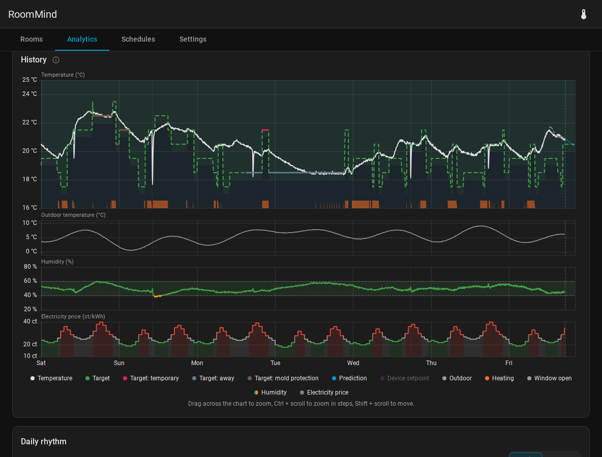

# RoomMind features in detail

The [README](../README.md) gives the overview. This page explains what each feature does and where its limits are. Device types, setpoint modes, idle behaviour and the `Priority` slider are covered in the [Control and Device Guide](control-and-devices.md).

## Control

### Self-learning model and predictive control

Per-room thermal model (Extended Kalman Filter) that learns your home's heating/cooling behavior over time. Automatic fallback to on/off control while learning. Rooms with a temperature sensor of their own get the full benefit, see [Full Control vs. Managed Mode](../README.md#full-control-vs-managed-mode).

### Pre-heating and pre-cooling

Before a warmer schedule block the room starts heating early enough to be warm when the block begins; rooms with an AC likewise start cooling before a cooler block. The lead is limited by the `Priority` slider in the settings and can be switched off per room ("Pre-heat before schedule blocks"). The room page and the room card show a running pre-heat with its target and start.

### Radiator afterglow

Radiator rooms learn how much heat is still released after heating stops and how long it lasts, and stop early enough not to overshoot.

### Proportional valve control

TRVs receive calculated setpoints instead of simple on/off, producing smoother temperature curves with less overshoot.

### Direct valve control

TRVs that expose their valve opening as `number` entities (e.g. SONOFF TRVZB) are held at the opening the room needs instead of switching between fully open and closed: fewer valve movements, quieter and steadier heat.

### Solar gain

Estimates solar irradiance from sun position and weather data. The model learns each room's solar response and reduces unnecessary heating.

## Schedules and targets

### Schedules

Create and edit schedules right in RoomMind: on a week grid on a computer, as a list of days on a phone. They stay normal Home Assistant schedule helpers, and the Schedules tab lists every helper with the rooms that use it. Every block can carry its own heating and cooling temperature, cover schedules a position. Multiple `schedule.*` entities per room with selector switching via `input_boolean` or `input_number`.

### Separate heat/cool targets

Independent comfort and eco temperatures for heating and cooling in auto mode, creating a natural dead-band.

### Manual override

Boost, eco, or custom temperature with configurable duration and instant UI feedback.

### Changes made on the device

Per room, optional (in the schedule settings). A temperature set on the TRV dial or the AC remote becomes the room target until the next schedule change, instead of being replaced by RoomMind. Needs devices that report their setpoint to Home Assistant; leave it off for devices that run their own schedule or are changed by automations, since RoomMind cannot tell those changes from a hand on the dial.

### Presence

Link `person.*`, `device_tracker.*`, `binary_sensor.*`, or `input_boolean.*` entities globally or per room. Eco temperature is used when all assigned persons are away. Rooms can opt out of presence detection to always follow their schedule.

### Eco when the room is empty

Per room, optional. Occupancy sensors (motion, presence) always help the thermal model learn how much heat people and devices add. With "Eco when the room is empty" turned on, they also control the room: once every occupancy sensor has reported the room empty for the delay (default 15 minutes), the room drops to its eco temperature, and it returns to its schedule as soon as someone is detected again. An empty room never gets a higher target than its schedule, and "off" stays off. An empty room is kept at eco and only heats to comfort once someone is in it, so a slow heating system may need an eco temperature close to comfort. An unavailable or missing sensor counts as occupied, and after a Home Assistant restart the delay starts over.

### Vacation

Global setback temperature with end date for all rooms.

## Devices

### Heat source selection

Rooms with both TRVs and ACs automatically route heating demand to the most efficient device based on temperature gap and outdoor conditions.

### Shared system: boiler or outdoor unit (compressor groups)

Settings > Shared system (boiler, outdoor unit). Define groups of climate devices sharing a boiler or an outdoor compressor. A main device (gas boiler, heat pump outdoor unit, main switch of a ducted system) is switched on as soon as a room in the group wants to heat or cool, and off when all rooms are idle. Enforces minimum run and off times to prevent short-cycling. Until `min_run_minutes` has elapsed, a device keeps its last active setpoint, including a boost setpoint, so the room can overshoot its target further than without protection. A target that changes on purpose in the meantime (override, vacation, schedule off, presence) is passed on to the device right away (a device with a single heat/cool setpoint only when that cannot push the room the wrong way).

### Idle modes

AC and heat pump devices can switch to fan-only or setback mode instead of turning off, keeping air circulation or low-load operation active. Optionally, setback turns the device off after a long pause with no demand ahead.

### Setpoint mode per device

Choose proportional (boost setpoint) or direct (exact target) control per device for optimal results with different hardware. For direct devices whose internal sensor reads differently from your room sensor, a setpoint offset shifts the temperature sent to the device.

### Climate control per room

Disable climate control for individual rooms while keeping other rooms active.

### Valve protection

Periodic cycling of idle TRV valves to prevent seizing and calcification.

## Around the room

### Windows and doors

Pauses climate control when windows or doors are open, with configurable open/close delays.

After a restart, RoomMind waits until the window sensors report a state (at most 5 minutes; a sensor that is still unavailable then counts as closed). A sensor that no longer exists at all (deleted or renamed) counts as closed right away once Home Assistant has finished starting, with a warning in the log. A sensor that drops out briefly keeps its last state.

### Covers and blinds

Smart cover deployment based on predicted solar overheating. Includes night close, manual override detection, cover schedules, and an optional per-room hold that keeps covers up while a window is open (checked every 30 s, a cover already moving is not stopped).

### Mold risk

Surface humidity estimation using the DIN 4108-2 method. Configurable notifications and automatic temperature raise to prevent mold growth.

### Air quality (CO₂/VOC)

Per room, optional. Add a CO₂ and/or VOC sensor in the room's sensor settings. From the threshold on (CO₂: 1000 ppm by default, the level from which the German Environment Agency asks for more fresh air) the room page and its tile on the RoomMind dashboard show a hint and `binary_sensor.roommind_{area_id}_air_quality` turns on; it turns off again below 80 % of the threshold (800 ppm). VOC sensors report an index, ppb or µg/m³, so the VOC threshold is entered in the sensor's own unit; without one the reading is only shown. Optionally pick a ventilation entity (`fan.*`, `switch.*` or `input_boolean.*`, e.g. an extractor fan or the boost of a ventilation unit): RoomMind switches it on when the air turns bad and off again once it is good, after at least 15 minutes. It only switches off what it switched on itself, leaves a fan alone that someone switched off during a bad spell, switches nothing on while climate control is off and switches its own fan off then. An AC's fan mode only recirculates the air and does not lower the CO₂, so RoomMind does not use it for this.

### Electricity price

Optional. Pick a price source (Tibber, Nordpool, EPEX Spot, aWATTar, ENTSO-e, Octopus, a template, or a switch that is on during PV surplus or off-peak) and let chosen rooms move their schedule target by up to 2 °C: a little warmer while it is cheap before expensive hours, a little cooler while it is expensive (cooling the other way round). Overrides, vacation and absence are never shifted. Rooms with radiators on gas next to an AC can also pick the heat source by price. The analytics page shows the price and how many heating hours fell into cheap and expensive times.

### Outdoor areas

Mark rooms as outdoor (e.g. balcony) to disable climate control while keeping monitoring.

## Analytics

Select a room and time range (24h / 7d / 30d / 90d / custom) to view temperature and humidity history, heating/cooling power, solar irradiance, and model predictions. Export as CSV or diagnostics report.

- **This period**: time on target (within 0.5° of the wanted band, open windows left out), too cold/too warm shares, mean deviation, heating and cooling hours with the number of runs, and window-open hours.
- **Daily rhythm**: an overview of at least 14 days by hour, with the selected range marked. It stays on the latest days, grows with a longer range (up to 31 days) and moves back for an older one. One view shows when the room heats or cools and when windows were open, the other when it missed its target. Hover or tap an hour for its figures, tap a day to show it in the chart above.
- **Heat loss** in the model card: how many degrees per hour the room loses without heating at 10° difference to outside, for comparing rooms or a renovation before and after. Degrees per hour, not watts, because RoomMind does not know the size of the room.

Humidity needs a humidity sensor on the room. Humidity and time on target start with the first readings after the update, older history has neither. Rooms with a CO₂ sensor get a CO₂ plot below the temperature, from the first reading on.
